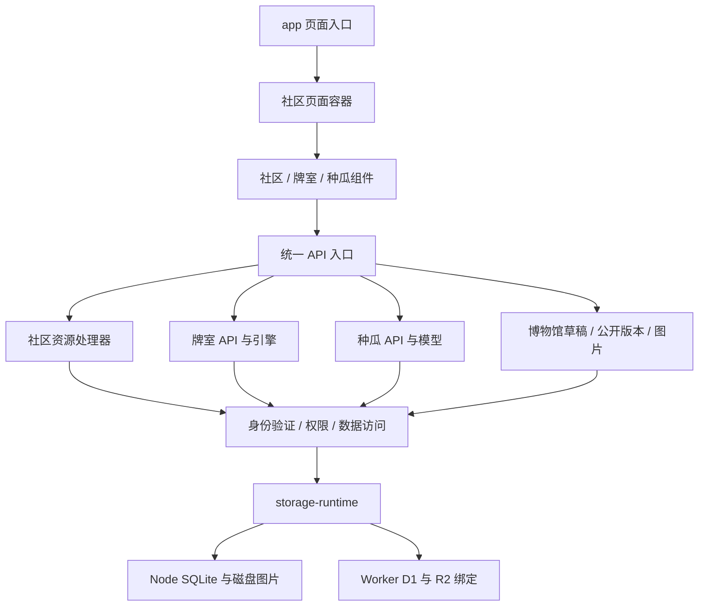

# 架构与模块边界

## 阅读顺序

先读根 README 与 [开发指南](development.md)，再按需求进入模块说明：[社区前端](../components/community/README.md)、[社区服务端](../lib/community/README.md)、[牌室](../lib/games/README.md)、[种瓜](../lib/garden/README.md)。

## 目录分工

| 目录 | 内容及编辑原则 |
| --- | --- |
| `app/` | 框架页面、布局、样式和薄 API 入口 |
| `components/community/` | 社区页面及客户端状态；牌室、种瓜组件暂保留在 components 下 |
| `components/ui/`、`vendor/` | 模板 UI 与第三方样式；不在这里放业务逻辑 |
| `lib/community/`、`lib/games/`、`lib/garden/`、`lib/museum/` | 业务模块，各自说明入口与测试；博物馆前端独立放在 `components/museum/` |
| `lib/server.ts` 与存储适配文件 | 服务端共享能力与运行环境边界 |
| `db/`、`drizzle/` | 数据定义、不可随意重写的已发布迁移 |
| `tests/unit/`、`tests/integration/`、`tests/fixtures/` | 纯规则、独立数据接口回归、最小测试图片 |
| `scripts/` | 构建/环境工具、初始化、种子数据和运维检查；保留既有入口 |
| `deploy/` | ECS 与 Cloudflare 工具，部署专用测试继续与工具相邻 |
| `docs/` | 开发说明、玩法及可公开验证记录 |
| `beta/`、`examples/` | 历史快照与参考示例，不是实际业务入口 |

## 两种运行方式

**Vinext/Worker**：`npm run dev` 和 `npm run build` 通过 Vite 构建。Vite 的精确别名将 `@/lib/storage-runtime` 替换为 Worker 绑定，使用本地 D1/R2 持久化。别名的优先级必须高于宽泛的 `@` 路径别名。

**Next.js/Node**：`npm run build:ecs` 构建 standalone 服务；默认 `storage-runtime` 使用 Node SQLite 与磁盘图片。Docker 启动前执行既有初始化脚本。两种环境共用 API 与迁移，但数据目录互相独立。

浏览器组件只能导入展示类型、路径工具和纯业务模型。不得通过聚合导出间接导入服务端会话、数据库或 `node:sqlite`。本次不增加混合前后端的模块 barrel。

## 请求约定

统一 API 入口负责路径前缀解析、非 GET 同源校验、分发和错误转换。资源处理器负责业务验证和授权；不支持的社区操作返回空结果交给入口生成 404。JSON 响应保持 no-store；上传图片在读取时检查可见性，返回 private/no-store。

`appPath`、`stripBasePath` 兼容根路径及 `/melon`。构建与启动必须使用一致前缀；生产 HTTPS 来源由私密环境配置提供。社区继续使用标准链接进行整页导航，避免破坏现有 Vinext 兼容行为。

## 新增功能放在哪里

- 改帖子展示：社区对应功能组件；不要加回页面容器。
- 加社区资源操作：对应服务端处理器，通过统一入口调用并补接口回归。
- 改牌局或签到规则：先改纯引擎/模型及规则测试，再改 API 或页面。
- 加持久化字段：新增迁移，不编辑已发布迁移。
- 改运行环境：同时检查 Worker 别名和 Node 构建，避免只在一套环境通过。

公开文档使用示例配置。真实域名、地址、联系人、账户、环境及备份位置保留在受控的私密配置中。
